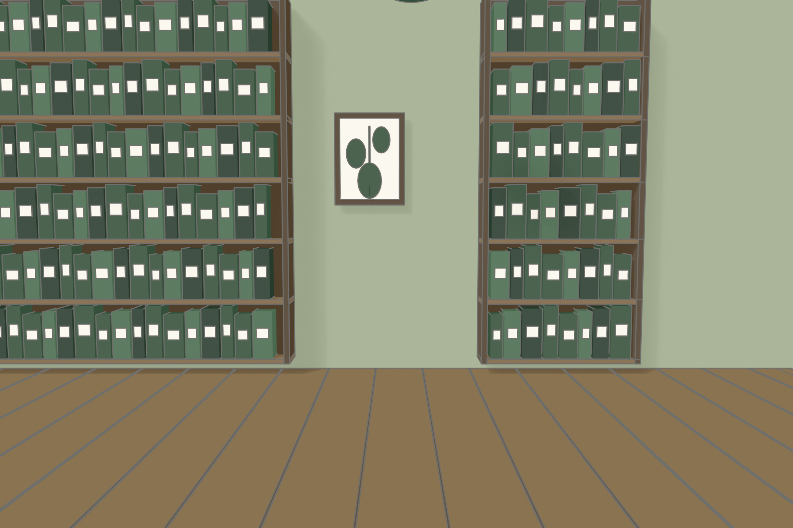

<p align="center">
  
</p>

<p align="center"><em>A quiet research library, kept by an old shopkeeper and his spider.</em></p>

<p align="center">
  
</p>

---

Finder-Keeper is a document search, retrieval and question-answering library wrapped in a story. You describe what you half-remember; the spider goes out of the window to find openly available full text, the Keeper files it into your collections, and when you ask a question he reads the pages and hands back an answer with citations you can open.

The main library at `/` is a calm scholarly workspace (Passages, Synthesize, Collections, Flows and the Commons) with the spider's threads drawn faintly in the background. The illustrated shop lives at `/clerk-room`. There the desk's drawers are your collections, every document is a mounted herbarium sheet with a collector's label, and the characters move only when a real request is being processed. Their animation never holds up a result.

## What it does

**Three jobs, one room**

| Job | What happens |
| --- | --- |
| **Find** online | Searches scholarly and open-book providers (OpenAlex, Unpaywall, OpenStax, Project Gutenberg, OAPEN), then *checks* each candidate for real free full text in PDF, HTML, EPUB or plain text. Previews, paywalls and catalogue-only entries are kept in a separate list and never labelled free. |
| **Recall** from your library | Semantic search over saved passages: describe a passage in your own words and get the exact span, with page or section, highlighted in the reader. |
| **Ask** the library | Grounded answers built only from your passages, with every citation checked against the text it came from. You can ask from inside an open document. |

**And around them**

- **Collections**: drawers on the desk, with dividers (sub-collections) inside. Search and ask can be scoped to a drawer.
- **Reader**: PDF pages with highlights, EPUB 2/3 in reading order with chapter sections, and HTML/text in numbered sections.
- **Uploads and imports**: PDF, EPUB, Markdown, text and HTML. Imports run as background jobs (queued → processing → searchable / failed) that you can retry or cancel.
- **Reading flows**: the Keeper plans a path through your library toward a goal, with a main route, "go deeper" detours and a final synthesis step. Flows are drawn as a map and a checklist.
- **Lending and the commons**: lend a collection to a friend by email or by link, publish open shelves and flows, and write reviews and notes on public reader profiles (`/u/<handle>`).
- **Accessibility**: a pause control, `prefers-reduced-motion` support with static poses, keyboard operation, and a layout composed separately for phones.

## How it is built

```
Next.js 16 / React 19  ──same-origin proxy──>  FastAPI (Python 3.12)
  workspace, shop, reader,                       ├─ discovery + full-text verification
  flows, commons                                 ├─ extraction (PDF, EPUB, HTML, text)
                                                 ├─ embeddings: BGE-small-en-v1.5 via FastEmbed (384-d, CPU)
                                                 ├─ retrieval: vectors + keyword + title signals
                                                 └─ answers: local Ollama (qwen2.5:3b) or grounded extraction
```

| Layer | Local (default) | AWS deployment |
| --- | --- | --- |
| Web | Next.js dev server | Lambda container behind CloudFront |
| API and worker | FastAPI and a local job worker | Lambda (API) + SQS-driven worker Lambda |
| Metadata and vectors | SQLite in `backend/.data` | Aurora PostgreSQL serverless + pgvector |
| Files | `backend/.data/files` | Private S3 with presigned uploads |
| Sign-in | One local user on loopback | Amazon Cognito (authorization code + PKCE, HttpOnly cookies) |

The local version needs no cloud account and makes no paid model calls. Embedding, retrieval and answering run on your machine.

**Art pipeline.** The room, drawer plates, the Keeper and the spider are rendered in Blender 5.2 from one camera into layered images and transparent animation atlases, so the page can place every element from the render's own landmarks. See [`art/herbarium/`](art/herbarium/README.md). The brand mark and wordmark are in [`art/brand/`](art/brand/), set in EB Garamond (OFL).

## Run it locally

Prerequisites: Node.js 22+, npm, Python 3.12 and [uv](https://docs.astral.sh/uv/getting-started/installation/).

```sh
./scripts/setup-local.sh   # installs node_modules and backend/.venv, creates .env if missing
./scripts/dev.sh           # web on 127.0.0.1:3000, API on 127.0.0.1:8010
```

Open <http://127.0.0.1:3000>. The first start downloads the embedding model once. After that, saved-library search and answers work offline. Starter documents are labelled, so you can try a paraphrased search right away and then upload your own.

Optional settings in `.env` (see [`.env.example`](.env.example)):

- `OPENALEX_API_KEY`, `UNPAYWALL_EMAIL`, `CONTACT_EMAIL`: better scholarly discovery.
- `OLLAMA_ENABLED=true`: use an already-installed local `qwen2.5:3b` for written answers. Without it, answers fall back to exact cited extracts.
- `SEED_LIBRARY=false`: skip the starter documents for a new database.

Default limits are 25 MB per file, 1,000 pages per PDF, 500 documents and 30 imports an hour. The local single-user mode trusts loopback, so keep it on `127.0.0.1` and don't tunnel it to the internet.

### Routes

| Route | What it is |
| --- | --- |
| `/` | The library workspace: Passages, Synthesize, Collections, Flows, Commons |
| `/clerk-room` | The rendered herbarium shop |
| `/sign-in` | The shop door (sign-in) |
| `/shared/<token>`, `/shelves/<id>`, `/flows/<id>`, `/u/<handle>` | Lent collections and the public commons |
| `/classic`, `/keeper-study`, `/ui-studies` | Earlier designs and interactive studies, kept for reference |

## Tests

```sh
npm run typecheck
npm run build
node --experimental-strip-types --test tests/*.test.mjs   # character, layout and flow-map checks
cd backend && uv run pytest                               # API, retrieval, extraction, sharing isolation
```

Some embedding integration tests need the model weights downloaded first.

## Deploy to AWS

[`infra/aws/deploy.sh`](infra/aws/deploy.sh) is an idempotent, serverless deployment (Lambda, SQS, S3, Aurora serverless with pgvector, Cognito, CloudFront) that runs only from a clean `main`. The [AWS guide](infra/aws/README.md) covers the architecture, costs, trade-offs and teardown. An older optional GCP Terraform foundation is described in [`infra/README.md`](infra/README.md).

## Your data

Locally, everything lives in `backend/.data` (database, original files and model cache), which git ignores. To back it up, stop the app first:

```sh
tar -czf ../finder-keeper-library-$(date +%Y%m%d).tar.gz -C backend .data
```

The backup contains your documents and extracted text, so keep it private. `.env` is deliberately not included.

## Honest boundaries

- OCR for scanned, image-only PDFs isn't implemented. Such files are kept and reported as unprocessable.
- DRM-protected EPUBs aren't supported.
- Full-text checks are conservative but bounded. They don't certify that an edition is complete.
- Some providers can fail or block requests (OAPEN returned HTTP 403 during development). Failures are shown, never hidden behind a fallback.
- Relevance scores rank results. They aren't confidence probabilities.

## Project documents

- [`PRODUCT.md`](PRODUCT.md): who it's for, principles and commitments
- [`DESIGN.md`](DESIGN.md): the shop's design system
- [`docs/phase-2-plan.md`](docs/phase-2-plan.md): what has shipped and what's next
- [`docs/BUILD_BRIEF.md`](docs/BUILD_BRIEF.md): the original product breakdown and acceptance notes
- [`backend/README.md`](backend/README.md): API, retrieval and configuration details

## License

No license has been chosen yet, so all rights are reserved. The bundled EB Garamond fonts are under the [SIL Open Font License](art/brand/fonts/OFL.txt).
